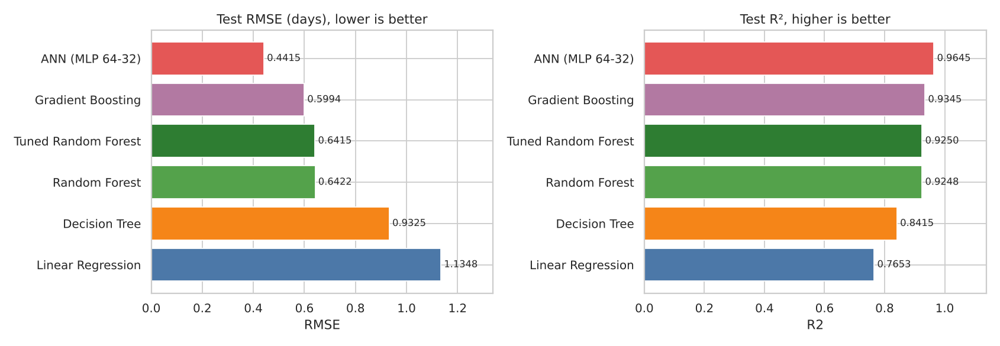
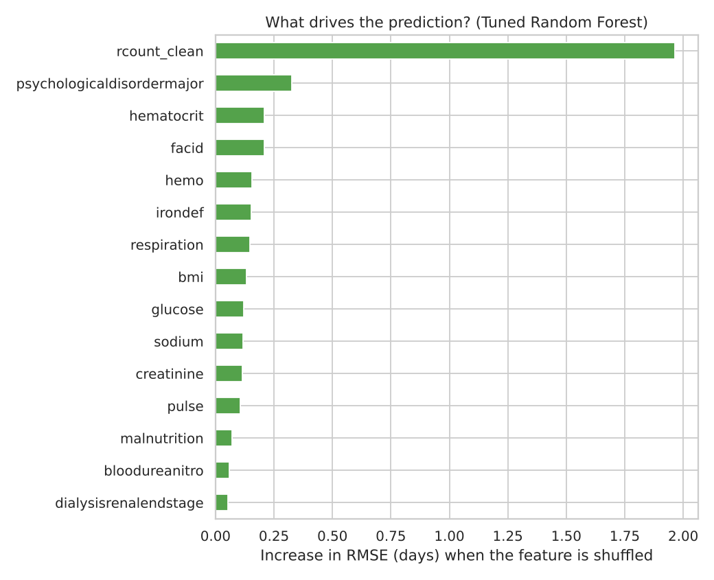
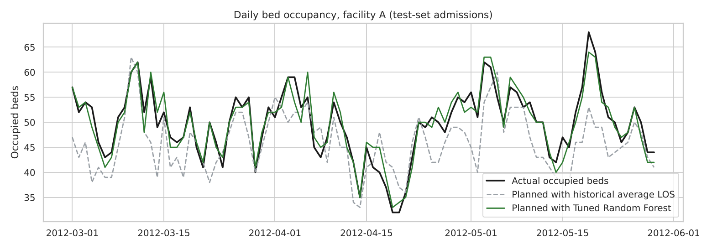
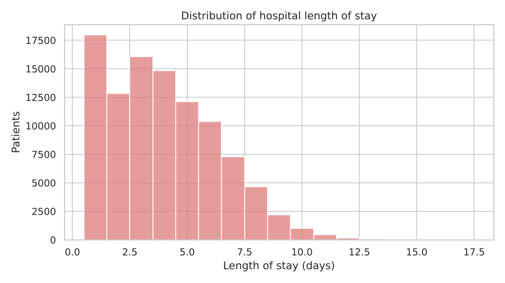
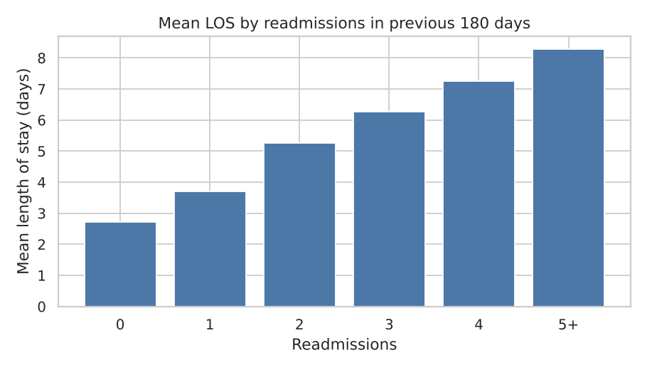
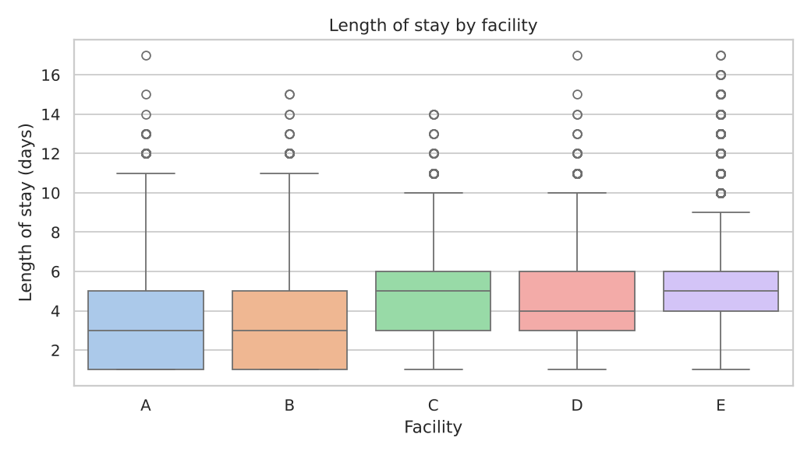
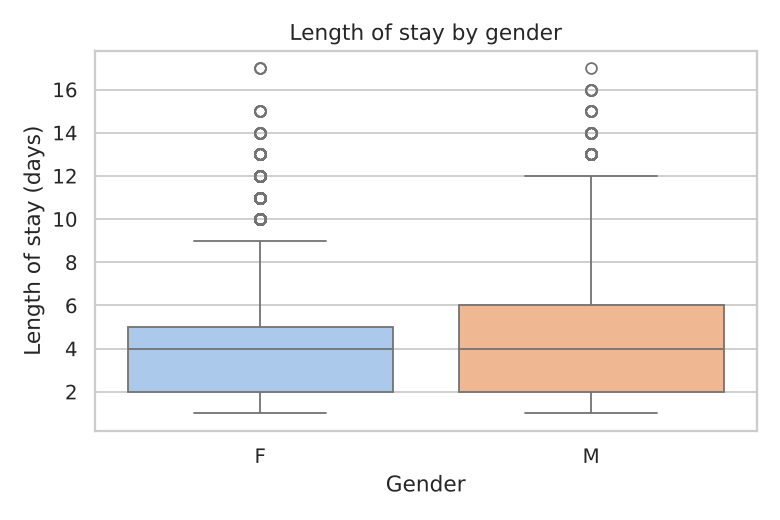

# AI-Powered Prediction of Hospital Length of Stay

**Predicting how many days a patient will stay in hospital — and turning that into bed and staffing plans.**

MSc Computing (Information Systems & Processes) dissertation · South East Technological University (SETU), 2026 · Meruva Vijaya Rama Seshu

 

📄 **Dissertation:** [PDF](Research_Work.pdf) · [Word](Research_Work.docx) &nbsp;|&nbsp; 📓 **Notebook:** [LOS_Analysis.ipynb](LOS_Analysis.ipynb)

---

## The problem

Hospitals usually plan beds and staff from *average* length of stay (LOS). But LOS varies widely — in this data from 1 to 17 days around a mean of 4 — so average-based plans are regularly wrong. This project tests whether machine learning can predict each patient's LOS at admission accurately enough to support bed-capacity and staffing decisions.

## Results

100,000 admissions, 80/20 train/test split (80,000 / 20,000), evaluated on the unseen test set:

| Model | MSE | RMSE (days) | MAE (days) | R² |
|---|---:|---:|---:|---:|
| Linear Regression (baseline) | 1.2879 | 1.1348 | 0.8664 | 0.7653 |
| Decision Tree | 0.8696 | 0.9325 | 0.5011 | 0.8415 |
| Random Forest | 0.4125 | 0.6422 | 0.3891 | 0.9248 |
| Gradient Boosting | 0.3593 | 0.5994 | 0.4431 | 0.9345 |
| **ANN (MLP 64-32)** | **0.1949** | **0.4415** | **0.2963** | **0.9645** |
| Tuned Random Forest (grid search) | 0.4116 | 0.6415 | 0.3887 | 0.9250 |



- **The ANN was the most accurate** (R² 0.96, typical error under half a day) but it is a black box and hit its iteration limit before converging.
- **Random Forest was stable**: 5-fold cross-validation RMSE per fold 0.646–0.662 (mean 0.654). Grid search picked 100 trees, unlimited depth, `min_samples_split=5`; tuning gave only a marginal gain (RMSE 0.6422 → 0.6415).
- Because explainability matters for clinical adoption, the dissertation recommends the tree ensembles as the practical choice and the ANN as a benchmark.

### What drives length of stay



**Readmissions in the previous 180 days** dominate: shuffling that one feature adds almost 2 days to the typical error. Major psychological disorder, haematocrit, the admitting facility and the haemoglobin / iron-deficiency flags follow. Patients with 5+ recent readmissions stay about three times as long as those with none (8.3 vs 2.7 days on average; figure below). These are associations in historical data, not causes.

## From predictions to beds and staff *(extension)*

The dissertation argues that LOS predictions matter because they drive bed and staff planning. The code tests that directly: for every test-set admission it builds the **daily occupied-bed count per facility** three ways — using actual LOS, using predicted LOS, and using the historical average LOS — and converts beds into nurses needed at an illustrative 1 nurse : 6 beds.



| Planning method | Avg. error in daily occupied beds | Worst day | Ward-days with wrong nurse count |
|---|---:|---:|---:|
| Historical average LOS (per facility) | 3.7 beds | 20 beds | 51% |
| Linear Regression | 2.2 beds | 12 beds | 35% |
| Tuned Random Forest | 1.5 beds | 9 beds | 24% |

Planning with the tuned Random Forest cuts the daily bed-count error by about **60%** versus the historical average (3.7 → 1.5 beds per ward per day) and roughly halves the days on which a ward would be rostered with the wrong number of nurses (51% → 24%).

The notebook's simple rule — *flag patients predicted to stay 7+ days as high bed/staff demand* — catches 73% of actual long stays, and 96% of flagged patients really do stay 7+ days.

## Method

1. **Data checks** — 100,000 rows × 28 columns, no missing values, no duplicates.
2. **Leakage prevention** — `discharged` is exactly admission date + LOS in 100% of rows, so it was removed. Keeping it would let a model "predict" LOS perfectly using information that only exists after discharge.
3. **Features** — 11 comorbidity flags, 6 lab results, BMI/pulse/respiration, secondary-diagnosis count, readmissions in the last 180 days (`5+` → 5), gender and facility (one-hot encoded). Numeric features median-imputed and standardised.
4. **Models** — Linear Regression, Decision Tree, Random Forest, Gradient Boosting and an ANN (MLPRegressor, 64→32, ReLU, Adam).
5. **Validation** — hold-out test set, 5-fold cross-validation and 3-fold grid search for Random Forest.
6. **Metrics** — MSE, RMSE, MAE and R²; plus share of patients predicted within ±1 day.

## Exploratory analysis

| | |
|---|---|
|  |  |
|  |  |

## Files in this repository

| File | What it is |
|---|---|
| `LOS_Analysis.ipynb` | The full analysis notebook from the dissertation — data checks, EDA, all five models, cross-validation, grid search |
| `LengthOfStay.csv` | Dataset: 100,000 admissions × 28 columns ([source](https://www.kaggle.com/datasets/aayushchou/hospital-length-of-stay-dataset-microsoft)) |
| `MetaData_Facilities.csv` | Names of the five facilities (A–E) |
| `Research_Work.pdf` / `.docx` | Dissertation |
| `train.py`, `data.py`, `models.py`, `evaluate.py`, `capacity.py`, `config.py` | The notebook rewritten as a reusable Python pipeline, plus the feature-importance and bed/staffing extensions |
| `test_pipeline.py` | Unit tests for the pipeline |
| `*.png` | Charts used in this README |

### Run the notebook

```bash
pip install -r requirements.txt
jupyter notebook LOS_Analysis.ipynb
```

In the notebook's loading cell, set the path to `"LengthOfStay.csv"` (the dataset sits in the same folder). Results match the tables above to four decimal places.

## Limitations

- One public dataset (Microsoft's resampled sample data, not real patients); models need external validation on local hospital data before any real use.
- Predictions use admission-time information only; LOS can change as a patient's condition changes.
- The ANN did not fully converge in 300 iterations; more tuning could change its ranking.
- The staffing ratio is an illustrative assumption, not a policy recommendation.
- Responsible use also needs explainability, bias monitoring across patient groups and facilities, GDPR-compliant data handling and human oversight — discussed in Chapters 2 and 5 of the dissertation.

## Tech stack

Python · pandas · NumPy · scikit-learn · Matplotlib · Seaborn · Jupyter · VS Code · Git

## Author

**Meruva Vijaya Rama Seshu** — MSc Computing (Information Systems & Processes), SETU
[GitHub](https://github.com/ramaseshu-Data) · [Portfolio](https://ramaseshu34.wixsite.com/vijaya-rama-seshu-me)
